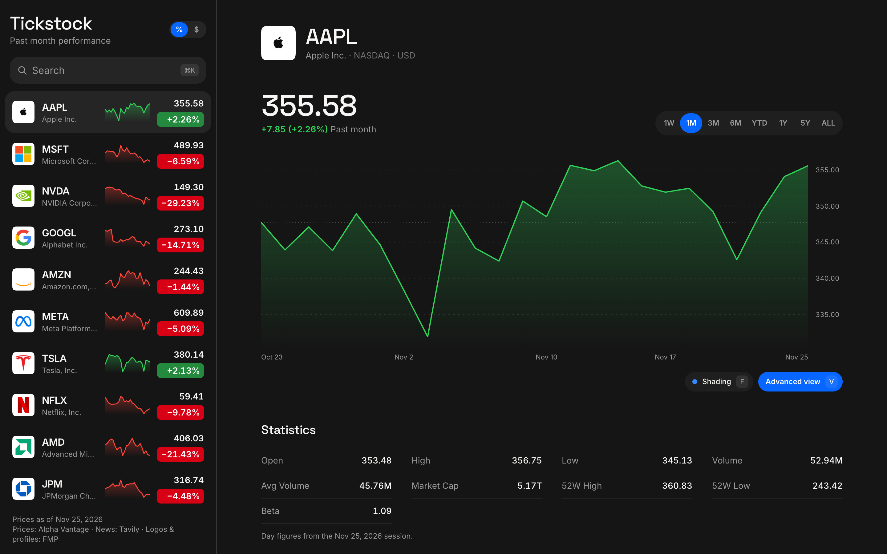
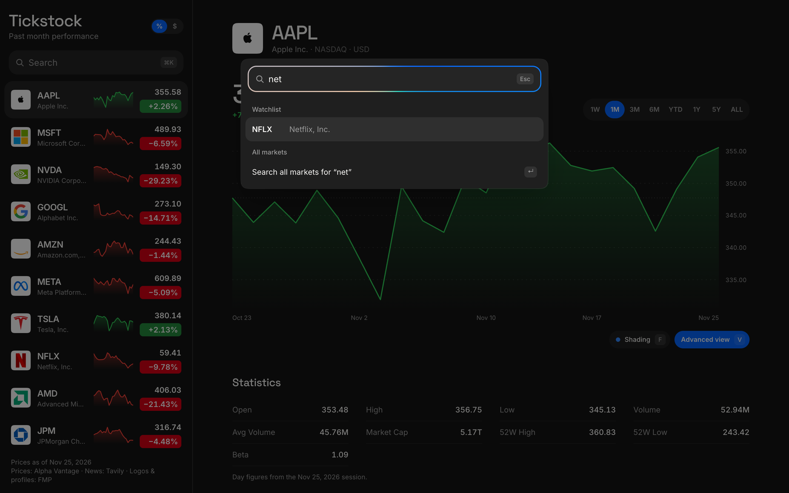
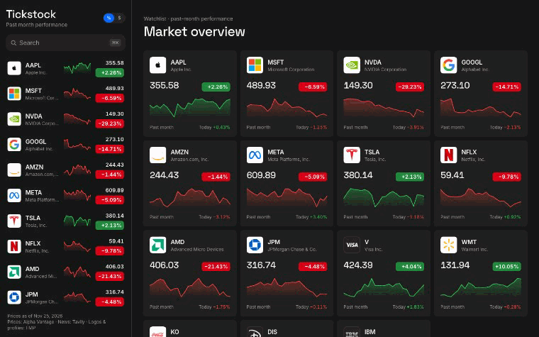

# Tickstock

A stock watchlist built with Next.js 16 (App Router) on the AlphaVantage API. It's modelled on Apple's Stocks app, plus a TradingView-style **advanced view** one keypress away.

**Live demo: [tickstock-gamma.vercel.app](https://tickstock-gamma.vercel.app)**


## Screenshots

| Market overview | Stock page |
| --- | --- |
|  |  |
| **Advanced view (`V`)** | **Search (`⌘K`)** |
|  |  |

**On phones** the list is the homepage. A stock opens as a sheet you can pull down to dismiss, and the advanced view works full-screen.

| Watchlist | Stock sheet | Advanced view | Pull to dismiss |
| --- | --- | --- | --- |
|  |  |  |  |

**Search:** the placeholder cycles through example queries. Typing filters instantly, and Enter opens the stock.



## Requirements checklist

| Requirement | Where |
| --- | --- |
| 15+ stocks on the homepage (table / tiles / cards) | Sidebar list plus tile grid (`app/page.tsx`, `components/quote-views.tsx`) |
| Clicking a stock opens its details page | `/stock/[symbol]` |
| Load the Company Overview and `TIME_SERIES_DAILY` from AlphaVantage | `lib/alphavantage.ts`. Company Overview is now premium-only, so see [why profiles can come from FMP](#why-company-profiles-can-come-from-financial-modeling-prep) |
| Symbol, asset type, name, description, exchange, sector, industry, market cap, with "N/A" when missing | About section (`components/stock/sections.tsx`) |
| Historical prices: date, close, volume, % change from the previous day | Historical prices table (`components/stock/price-history.tsx`) |
| Bonus: responsive / mobile friendly | Phone layout with bottom sheets, safe areas and touch targets |
| Bonus: company logos on the homepage and stock page | `components/logo.tsx` |
| Bonus: fancy loading animation | Skeletons everywhere, plus a price line that keeps drawing itself (`app/stock/[symbol]/loading.tsx`) |
| Bonus: price history line chart | Interactive chart with ranges from 1W to ALL, scrubbing and keyboard inspection |

Beyond the brief:
- Red/green by period.
- A toggleable shaded area under every line (`F`).
- Company news via the Tavily search API.
- Apple-style statistics.
- ⌘K search across every US listing.
- The advanced view.

## Running locally

```bash
npm install
cp .env.example .env.local   # fill in the keys below
npm run dev
```

| Variable | Where to get it | Used for |
| --- | --- | --- |
| `ALPHAVANTAGE_API_KEY` | https://www.alphavantage.co/support/#api-key (free) | Prices, symbol search, Company Overview (premium) |
| `TAVILY_API_KEY` | https://app.tavily.com (free tier) | Company news |
| `FMP_API_KEY` | https://site.financialmodelingprep.com (free tier) | Company profiles when Company Overview is unavailable |

- **No keys needed to try it.** Without keys the app serves the committed snapshot in `data/cache/` and shows a "Cached snapshot" badge.
- **See the intended motion with a production build.** React's development build can stall the advanced-view animation, so for the real feel run:

  ```bash
  npm run build && npm start
  ```

## Deployment

The live demo runs on **Vercel**, connected to this repository, so every push to `main` redeploys automatically.

| Concern | How it's handled |
| --- | --- |
| Market data on a serverless host | The committed snapshot ships with every route (`outputFileTracingIncludes` in `next.config.ts`). Pages are prerendered from it, so the site never waits on a rate-limited API for watchlist stocks. |
| Keeping it fresh | A GitHub Action (`.github/workflows/snapshot.yml`) runs the quota-aware `npm run snapshot` every weekday after the US close. It commits any changed data, which triggers a redeploy. |
| No wasted quota at runtime | Vercel's filesystem is read-only and its instances are short-lived, so background refreshes are disabled there (`lib/file-cache.ts`). Only data that isn't in the snapshot, such as a stock found through search, is fetched live. |
| Configuration | Set the three API keys as Vercel environment variables (Production) and as GitHub Actions secrets (for the daily refresh). |

## Keyboard shortcuts

| Key | Action |
| --- | --- |
| `⌘K` / `Ctrl K`, `/` | Search and actions |
| `F` | Toggle shading under charts |
| `V` | Switch a stock between standard and advanced view |
| `Esc` | Close the menu or palette, then leave advanced view |
| `C` / `M` | Crosshair / measure tool (advanced view) |
| `+` / `-` / `0` | Zoom in / out / fit (advanced view; scroll and drag also zoom and pan) |
| `←` / `→` | Move the crosshair when a chart is focused |

To get back to the overview, click the **Tickstock** title or choose "Go to market overview" in the palette. On phones, swipe the stock sheet down or tap ✕.

## Advanced view

The standard stock page is Apple-like. The advanced view gives the app its own identity: a TradingView-style workspace made of panels floating on black.

| Area | Contents |
| --- | --- |
| Toolbar | Symbol search, candles / line, an Indicators menu (Volume, MA 20, MA 50), shading |
| Left rail | Crosshair and measure tools, plus zoom and fit |
| Chart | Candlesticks with volume and moving averages, an OHLC legend that follows the crosshair, axis tags, scroll-to-zoom and drag-to-pan |
| Bottom bar | Ranges |
| Right panel | Watchlist table, plus a symbol card with price, volume vs. average and the 52-week range |

**How the switch stays seamless and fast:**
- **One shared element, line to candles in two steps.**
  1. **Morph.** The advanced chart mounts as a full-height line shaped like the standard chart. The view transition morphs one line into the other: both snapshots stretch to fill the moving box and dissolve through a blur. Meanwhile the toolbar drops in, the side panel slides in, and everything else crossfades.
  2. **Unfold.** Inside the chart, the line stretches down into its price band while the candles dissolve in over it. Volume, axes and the legend fade in.

  Entering takes about 800ms in total and leaving takes 240ms. The unfold uses CSS transitions, so a range or style change mid-way redirects smoothly.
- **Cheap animations only.** Only the chart changes size; every other animation is transform or opacity. A single morph keeps the browser's snapshot work small.
- **Nothing reloads or reflows.** The standard page stays mounted underneath the workspace. Only its chart plot hides, inside a fixed-size box, so leaving advanced view causes no relayout and replays no animations. The selected range is shared, so you keep your place, and picking another stock in the watchlist stays in advanced view.
- **Phones skip the view transition.** Full-screen snapshots are too heavy for phone GPUs, so the workspace slides up as one compositor-only layer. Users who prefer reduced motion get an instant switch.
- **The switch never blocks input.** It is always a non-blocking React transition, so a tap or key press responds immediately.
- **Scrubbing stays cheap.** Each candle color, wick color and volume color is drawn as a single SVG path. The bars are memoized, so moving the crosshair redraws only the overlay, not ~1,350 weekly bars.

**Performance trade-off.** An earlier version also morphed the watchlist (on an arc), the price, the symbol, the logo, the search box and the range tabs, with extra motion on the chart. It looked richer but stuttered on slower machines and phones, so it was cut back.

Production build, CPU throttled (desktop 4×, phone 6×), worst frame during the switch:

| | Before | After |
| --- | --- | --- |
| Desktop enter / exit | 92ms / 87ms | 58ms / 37ms |
| Phone enter / exit | 129ms / 121ms | 46ms / 17ms |

Long tasks on phone exit dropped from 384ms to 0ms. The remaining ~60ms desktop frame is the browser's one-time snapshot, which every view transition pays.

## Why company profiles can come from Financial Modeling Prep

The challenge asks for the stock page to load AlphaVantage's **Company Overview** (`OVERVIEW`). Since this challenge was written, AlphaVantage has moved that endpoint to its **premium plans**. A free key now gets "This is a premium endpoint" instead of data. Only the public `demo` key still returns it, and only for IBM.

So the app tries both, in this order (`lib/sources.ts`):

1. **AlphaVantage `OVERVIEW` first, every time.** The requirement is implemented as written, and with a premium key the AlphaVantage data is used as-is.
2. **Financial Modeling Prep's free company profile when AlphaVantage refuses.** The fallback covers a premium-gate, an exhausted quota or a missing key. FMP fills the same required fields: name, asset type, description, exchange, sector, industry and market cap, plus beta and the 52-week range. FMP already supplies the logos, so no new vendor is involved.
3. **"N/A" for anything neither provider returns,** as the requirements specify.

Whenever the FMP fallback was used, the About section says so, so the source is never hidden. FMP's profile has no P/E, EPS or dividend yield, so those statistics only appear when AlphaVantage supplies them.

## Living with the free tier (25 AlphaVantage calls a day)

The homepage alone needs 15 calls, so the data layer is built around saving quota:

1. **Persistent stale-while-revalidate cache** (`lib/file-cache.ts`). Every response is written to `data/cache/<kind>/<SYMBOL>.json`.
   - Stored data is served immediately. Stale entries refresh in the background (locally), and the network blocks only when nothing is stored yet.
   - Failed refreshes back off for 15 minutes.
2. **The committed cache is the fallback snapshot.** When the quota is spent, users still get real (older) data, with an honest badge.
3. **`"use cache"` on top** (`lib/market.ts`). Successful loads are cached for hours, while failures are cached for minutes so a refilled quota is picked up quickly.
4. **Calls are throttled** about 1 per second, since bursts trip AlphaVantage's limit.
5. **Prefetching** fetches only the shared page shell by default. Hovering a stock prefetches the full page, so a page full of links never burns quota.
6. **Ranges are split by source.** Free daily data covers about 100 trading days, so 1W to 3M use the daily series and 6M to ALL use the weekly series.

Refresh the snapshot with:

```bash
npm run snapshot
```

It fetches missing entries first, then the oldest, so if the quota cuts a run short, the next day's run picks up where it left off.

## Design decisions

### One period per view

In the list, the sparkline, the change pill and the red/green color all describe the **same period (1 month)**, so a row never shows a red line next to a green pill. Desktop tiles also show today's move. The stock page opens on the same 1M range.

## Project layout

```
app/                 routes (layout with sidebar, homepage tiles, /stock/[symbol]) and the search server action
components/          UI: sidebar, quote rows and tiles, command palette, sheet, logo, sparkline
components/stock/    stock page: chart, range tabs, statistics, profile, news, history, sheet, standard/advanced switch
components/advanced/ advanced view: context, workspace, candle chart, watchlist + details panel
lib/                 AlphaVantage, Tavily and FMP clients, cache, data sources, series math, formatting, preferences
data/cache/          committed snapshot / persistent cache
scripts/snapshot.mts refreshes the snapshot within the daily quota
.github/workflows/   daily snapshot refresh
docs/media/          README screenshots and GIFs (captured from a production build)
```
