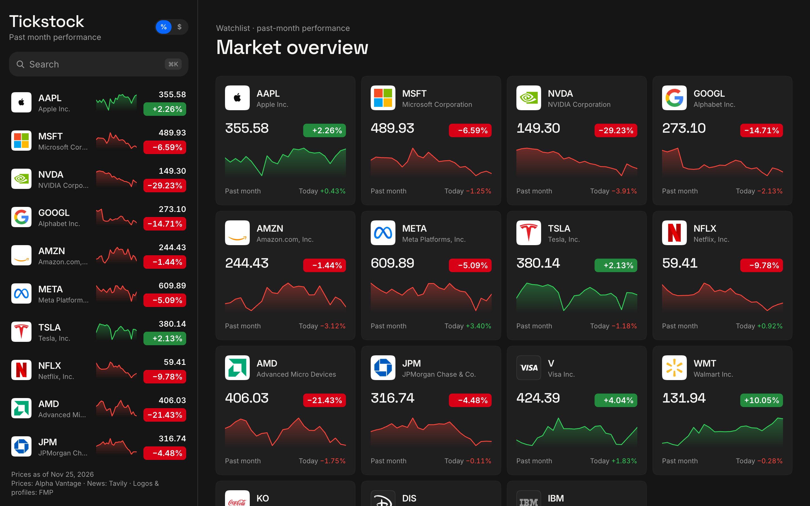
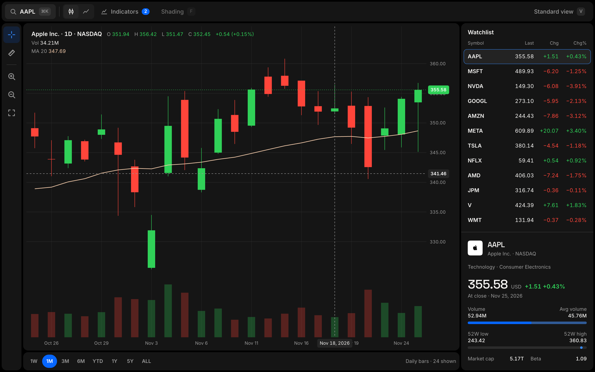
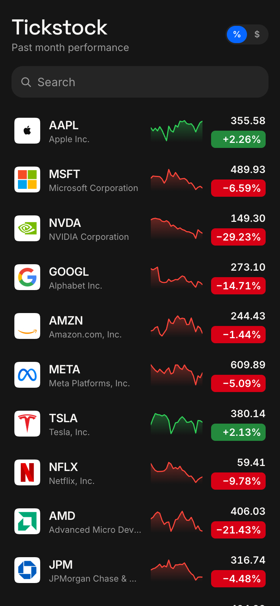
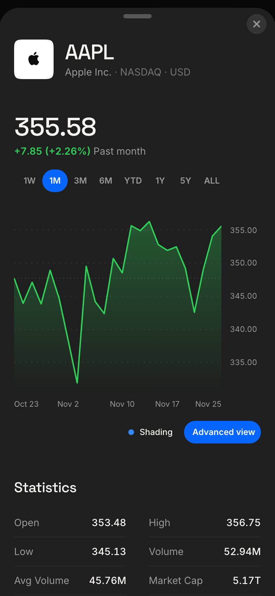
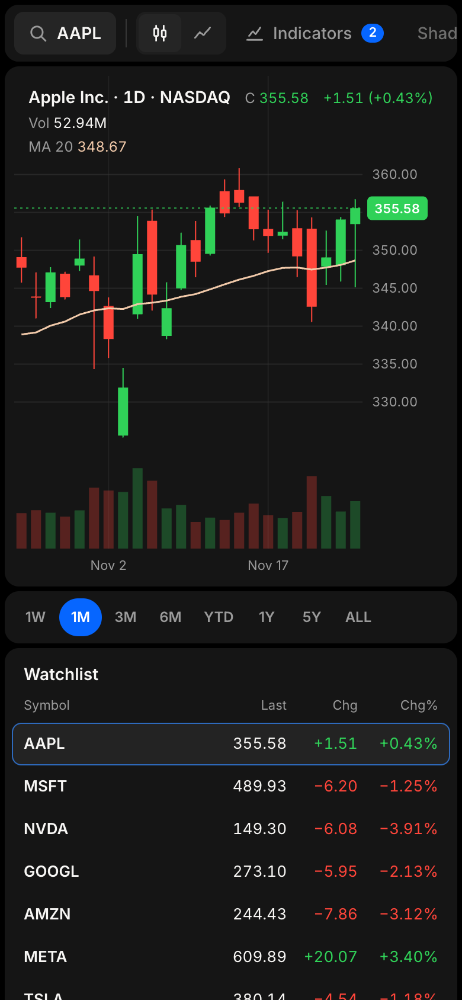
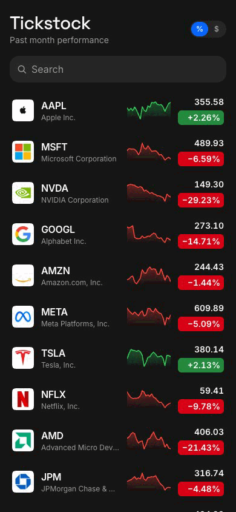

# Tickstock

A stock watchlist inspired by Apple Stocks, with a TradingView-style chart view one keypress away.

**Try it live: [tickstock-gamma.vercel.app](https://tickstock-gamma.vercel.app)**


## Screenshots

| Overview | Stock page |
| --- | --- |
|  |  |
| **Advanced view** (press `V`) | **Search** (press `⌘K`) |
|  |  |

On phones, the list is the home screen and each stock opens as a sheet you can swipe down to close.

| Watchlist | Stock | Advanced view | Swipe to close |
| --- | --- | --- | --- |
|  |  |  |  |

## What it does

- **Watchlist of 15 stocks:** logos, price, a 1-month mini chart and the change, in green or red.
- **Stock pages:**
  - an interactive price chart (1 week to all time)
  - key statistics and company info
  - recent news
  - daily price history
- **Advanced view:** candlesticks, volume, moving averages, zoom and a measuring tool. Press `V` to switch.
- **Search:** filter the watchlist instantly, or press Enter to search every US stock.
- **Works on phones**, with smooth animations that respect reduced-motion settings.

## Assignment checklist

| Requirement | Done |
| --- | --- |
| Show 15+ stocks on the homepage | ✅ List and tiles |
| Clicking a stock opens its details page | ✅ |
| Load Company Overview and daily prices from AlphaVantage | ✅ (see [the note on company data](#a-note-on-company-data)) |
| Symbol, asset type, name, description, exchange, sector, industry, market cap, with "N/A" when missing | ✅ |
| Price history with date, close, volume and % change | ✅ |
| Bonus: mobile friendly, logos, loading animation, line chart | ✅ All four |

## Run it locally

```bash
npm install
cp .env.example .env.local   # add your keys (optional, see below)
npm run dev
```

**No keys? It still works.** The app ships with saved market data. If that data is more than a day old, a "Cached snapshot" badge says so.

To use live data, add any of these free keys to `.env.local`:

| Key | Used for | Get one |
| --- | --- | --- |
| `ALPHAVANTAGE_API_KEY` | Prices and search | [alphavantage.co](https://www.alphavantage.co/support/#api-key) |
| `TAVILY_API_KEY` | News | [tavily.com](https://app.tavily.com) |
| `FMP_API_KEY` | Company info | [financialmodelingprep.com](https://site.financialmodelingprep.com) |

For the smoothest animations, run a production build: `npm run build && npm start`.

## Keyboard shortcuts

| Key | Action |
| --- | --- |
| `⌘K` or `/` | Search |
| `V` | Switch between the standard and advanced view |
| `F` | Toggle the shading under charts |
| `Esc` | Close menus, or leave the advanced view |
| `C` / `M` | Crosshair / measure tool (advanced view) |
| `+` / `-` / `0` | Zoom in / out / reset (advanced view) |

To get back to the overview, click the **Tickstock** title.

## How it works

### Staying within the free API limits

AlphaVantage's free plan allows only **25 requests a day**, and the homepage alone needs 15. So:

- **Responses are saved** to `data/cache/` and reused. Saved data shows instantly and refreshes in the background.
- **The saved data is committed to the repo.** If the daily limit runs out, the app still shows real (slightly older) prices.
- **A daily GitHub Action** refreshes that data after the US market closes and redeploys the site.

### A note on company data

The assignment asks for AlphaVantage's Company Overview, but AlphaVantage has since made it a paid feature. The app still asks AlphaVantage first. When that's refused, it gets the same fields from Financial Modeling Prep's free plan, and the page says which source was used. Anything still missing shows "N/A".

### The advanced view transition

Pressing `V` morphs the line chart into the candlestick chart:

1. The line stretches and blurs into place.
2. It unfolds into candles while the volume and axes fade in.

Only the chart animates in size; everything else uses cheap fades and slides. On phones, the view simply slides up, which keeps it smooth on slower devices.

### One period at a time

In the watchlist, the mini chart, the change and its color all cover the **same period (1 month)**, so they never contradict each other. Today's move is shown separately and labelled "Today".

## Project structure

```
app/                  Pages: overview, stock details
components/           UI: watchlist, search, charts, sheets
components/advanced/  The advanced chart view
lib/                  API clients, caching, chart math
data/cache/           Saved market data
scripts/snapshot.mts  Refreshes the saved data (npm run snapshot)
```
